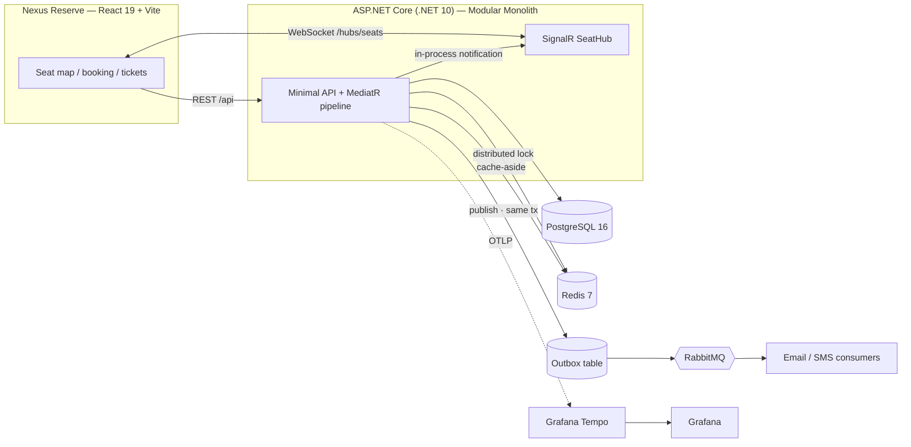
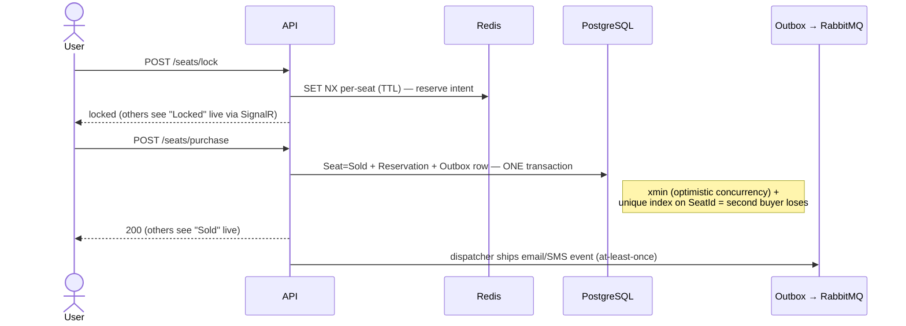

# TicketReserve

> A real-time event **seat reservation** system built as a deep-dive backend engineering portfolio — concurrency-safe booking, reliable messaging, live seat updates, distributed caching, and full observability.


---

## Overview

TicketReserve models the hardest part of any ticketing product: **letting many users compete for the same seats without double-selling one.** The frontend ("Nexus Reserve", React 19) shows a live seat map; the backend (ASP.NET Core, .NET 10) enforces correctness under concurrency and broadcasts every seat change to everyone viewing the same event in real time.

It is intentionally a **modular monolith**. The goal was not to ship the most services, but to implement the patterns that distributed systems rely on — transactional outbox, idempotent consumers, optimistic concurrency, distributed locks, real-time transport, cache invalidation, distributed tracing — and to be able to defend *why* each decision was made and *what breaks without it*.

## Key Features

- 🎟️ **Concurrency-safe booking** — a seat can be locked, purchased, and released by many users at once without ever double-selling, guarded by **two independent layers**.
- ⚡ **Live seat map** — lock/sell/release is pushed to every connected viewer of that event over **SignalR** (WebSocket), no polling.
- 📨 **Reliable side effects** — purchase and registration emails/SMS are delivered via a **Transactional Outbox + idempotent consumers**, so they survive crashes and broker downtime.
- 🚀 **Distributed caching** — read models are cached in Redis through a **MediatR pipeline behavior** (cross-cutting, zero handler code) with explicit invalidation.
- 🔐 **Auth & abuse protection** — JWT + ASP.NET Identity, role-based authorization, per-user/IP rate limiting, resource-ownership checks.
- 🧾 **My tickets & cancellation** — users list their reservations and cancel them; a cancel frees the seat and broadcasts it live.
- 🔭 **Observability** — OpenTelemetry distributed tracing to **Grafana Tempo**, correlation IDs propagated across the async boundary, structured logs with trace IDs.
- ✅ **Tested & CI'd** — integration tests on real infrastructure via **Testcontainers**, run on every push in GitHub Actions.

## Architecture

Vertical Slice Architecture + CQRS with MediatR. Each feature is a self-contained folder (`Command`/`Query` + `Handler` + `Endpoint` + `Validator`). Cross-cutting concerns (logging, validation, caching) are MediatR **pipeline behaviors**. Endpoints are minimal APIs auto-discovered via an `IEndpoint` marker. Outcomes flow back through a **Result pattern** mapped to RFC 7807 ProblemDetails.



### Booking flow — concurrency + reliability in one path



## Engineering Highlights

These are the decisions the project exists to demonstrate — each with a concrete trade-off, not "best practice."

- **Two-layer concurrency.** A Redis `SET NX` lock reserves a seat *before* payment (fast, cross-request, TTL-bounded), while PostgreSQL `xmin` optimistic concurrency + a unique index on `Reservation.SeatId` is the *last line of defense* at commit. The lock prevents the race; the DB constraint guarantees correctness even if the lock expired mid-checkout.
- **One event, two delivery guarantees.** Purchase confirmation emails go through the **Transactional Outbox** (written in the same `SaveChanges` as the sale → at-least-once, crash-safe). Live seat updates go through an **in-process MediatR notification → SignalR** (best-effort, instant). Money must not be lost; a dropped UI delta is simply re-fetched from the REST snapshot. Same fact, deliberately different transport.
- **Cache invalidation is a dual-write.** Reads are cached via a generic `CachingBehavior` gated by an `ICacheableQuery` marker; writes explicitly evict the key. This is honestly acknowledged as a dual-write, backstopped by a TTL.
- **Security by default.** Cancellation enforces **resource ownership** (not just authentication) to prevent IDOR, and returns `404` for both "not found" and "not yours" so reservation IDs can't be enumerated.
- **Correlation across the async boundary.** A correlation ID rides the message onto RabbitMQ and is restored in the consumer's log scope, so one request is traceable end-to-end — reinforced by OpenTelemetry `traceparent` propagation.

## Tech Stack

| Layer | Technologies |
|---|---|
| **Backend** | ASP.NET Core (.NET 10), Minimal APIs, MediatR (CQRS + pipeline behaviors), FluentValidation, EF Core + Npgsql |
| **Data** | PostgreSQL 16, Redis 7 (StackExchange.Redis + IDistributedCache) |
| **Messaging** | MassTransit 8 + RabbitMQ, EF Core Transactional Outbox + Inbox idempotency |
| **Realtime** | SignalR (WebSocket) |
| **Auth** | JWT Bearer, ASP.NET Core Identity, role-based authorization, rate limiting |
| **Observability** | OpenTelemetry (OTLP) → Grafana Tempo + Grafana, Serilog (+ trace enrichment), correlation IDs |
| **Frontend** | React 19, TypeScript, Vite, Tailwind CSS 4, Zustand, React Router, `@microsoft/signalr`, Axios |
| **Testing / CI** | xUnit, Testcontainers (Postgres/Redis/RabbitMQ), WebApplicationFactory, GitHub Actions |

## Getting Started

### Prerequisites

- [.NET 10 SDK](https://dotnet.microsoft.com/download)
- [Node.js 20+](https://nodejs.org/)
- [Docker Desktop](https://www.docker.com/products/docker-desktop/) (Postgres, Redis, RabbitMQ, Tempo, Grafana)

### 1. Start infrastructure

```bash
docker compose up -d
```

### 2. Configure secrets (JWT key + seeded admin password)

Secrets are read from user-secrets, not committed to source control:

```bash
cd TicketReserve.Api
dotnet user-secrets set "Jwt:Key" "<a-long-random-secret>"
dotnet user-secrets set "SeedAdmin:Email" "admin@ticketreserve.local"
dotnet user-secrets set "SeedAdmin:Password" "<admin-password>"
```

> On first run, an admin account is seeded from these values (skipped if an admin already exists).

### 3. Apply database migrations

```bash
dotnet ef database update --project TicketReserve.Api
```

### 4. Run the API

```bash
dotnet run --project TicketReserve.Api --launch-profile https
# → https://localhost:7233   (Swagger/OpenAPI in Development)
```

### 5. Run the frontend

```bash
cd client
npm install
echo "VITE_USE_MOCKS=false" > .env   # talk to the real backend (Vite proxies /api and /hubs)
npm run dev
# → http://localhost:5173
```

### Dashboards

| Tool | URL |
|---|---|
| Grafana (traces) | http://localhost:3000 |
| RabbitMQ management | http://localhost:15672 (`guest` / `guest`) |

## API

| Method | Route | Description |
|---|---|---|
| `POST` | `/auth/register` · `/auth/login` | Register / obtain a JWT (login is rate-limited) |
| `GET` | `/events` · `/events/{id}` | List events / event details (cached) |
| `POST` `PUT` `DELETE` | `/events` · `/events/{id}` | Event CRUD (Admin, cache-invalidating) |
| `POST` | `/events/{id}/seats` | Generate a seat layout (Admin) |
| `GET` | `/events/{id}/seats` | Seat map (DB status + live Redis locks) |
| `POST` | `/events/{id}/seats/lock` · `/release` | Lock / release seats (per-user rate-limited) |
| `POST` | `/events/{id}/seats/purchase` | Purchase locked seats |
| `GET` | `/reservations/me` | Current user's tickets |
| `DELETE` | `/reservations/{id}` | Cancel a reservation (ownership-checked) |
| — | `/hubs/seats` | SignalR hub for live seat status |

## Project Structure

```
TicketReserve.Api/
├─ Features/                # Vertical slices: Auth, Events, Seats, Reservations
│  └─ <Feature>/            #   Command/Query + Handler + Endpoint + Validator
├─ Infrastructure/
│  ├─ Behaviors/            # MediatR pipeline: Logging, Validation, Caching
│  ├─ Caching/              # ICacheService, Redis impl, ICacheableQuery, CacheKeys
│  ├─ Locking/              # Redis seat-lock service (SET NX)
│  ├─ Messaging/            # MassTransit consumers (Email/SMS)
│  ├─ Notifications/        # Notification services behind interfaces (DIP)
│  ├─ Realtime/             # SignalR SeatHub + seat-status notification
│  ├─ Auth/ · Correlation/ · ExceptionHandling/ · Endpoints/ · Seed/
├─ Data/                    # DbContext, entities, interceptors (soft delete)
└─ Program.cs               # Composition root + request pipeline

TicketReserve.Api.Tests/    # Integration tests (Testcontainers + WebApplicationFactory)
client/                     # React 19 + Vite SPA ("Nexus Reserve")
```

## Testing

Integration tests spin up **real** Postgres, Redis, and RabbitMQ containers (Testcontainers) and exercise the API through `WebApplicationFactory` — including a concurrency test that fires two parallel purchases at the same seat and asserts exactly one wins.

```bash
dotnet test
```

The suite runs on every push/PR via GitHub Actions.

---

> Built as a learning-driven portfolio project. The emphasis throughout is on understanding the *why* behind each pattern and what fails in its absence — not on breadth of frameworks.
